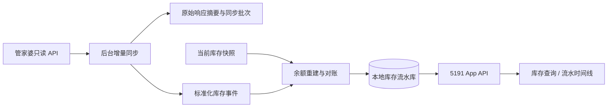

# UL 随行：物流更新与库存流水路线记录

日期：2026-09-21。状态：只读可行性结论与后续实施基线；本轮未修改 App、5191、5088 或 ERP 数据。

## 1. 已记录的物流更新结论

等取得可用 Token 后，订单处理更新优先改造成“后台 API 读取、规则计算、差异写入、ERP 回读核对”，App 只负责发起任务和查看结果。物流公司在当前业务中承担订单状态字段，合法状态包括 LS库存件、LD库存件、LM库存件、DQ库存件、QT库存件、待到货、需采购、来货件、催货、异常；不生成通用“库存件”。

采购在途量的改进口径记录为：

```text
采购未到货估算量 = 可销售库存 - 实物库存 + 销售未完成数量
```

用户已确认：旧脚本的普通采购来源没有覆盖委外采购，因此一部分旧结果“需采购”改判为“待到货”属于预期修正。计算必须按仓库、商品/SKU、基本单位执行；若推算量为负数，先重新读取数据，仍为负数则标记数据冲突并保留原状态，不能把负数当作正常采购量写回。

状态规则基线：

- 实物库存足够覆盖需求：按商品编码前缀写入对应的五类库存件。
- 实物库存不足，但实物库存与总在途足够：待到货。
- 加上总在途仍不足：需采购。
- 实际入库流水已分配到订单且满足需求：来货件。
- 已分配的实际入库超过 7 天，订单仍未完成：异常。
- 催货仍需要采购或委外批次日期、供应商及销售交期；只有总在途数量无法可靠判断催货。

2026-09-20 静态数据对照结果：17,079 个库存 SKU 中，公式与普通采购来源在 17,018 个 SKU 上完全一致（99.643%）；1,047 个有销售需求的 SKU 中 1,012 个一致（96.657%）；2,658 张订单中 2,632 张基础分类一致，26 张由旧“需采购”修正为“待到货”。另有 9 个销售需求 SKU 推算为负数，必须进入数据冲突保护。

已测性能基线：

- 单笔 `beefun.orderfreight.updatefreight` 请求约 607 ms，ERP 服务端记录约 1 秒内更新。
- 奇门单订单精确查询平均约 483 ms。
- WMS 未完成订单全量读取 3,959 条、20 页、并发 4，耗时约 19.8 秒。
- 最近一天单据中心读取 10 张单据约 1.34 秒。
- 当前浏览器自动化全流程约 317 秒，其中主要耗时来自四类导出和工作簿刷新。

据此估算，API 差异更新的日常任务约 40–90 秒，变更较多时约 1–2 分钟，首次全量约 2–4 分钟。这些是根据已测调用和近期差异量得到的工程估算，最终批量上限、限流和 Token 稳定性仍需实测。详细安全写入流程继续以 [订单处理更新 API 方案](ERP_API_ORDER_UPDATE_DESIGN_2026-09-16.md) 为准。

## 2. 库存流水功能的可行性结论

可以实现，而且适合放在 App 的库存查询结果中。可可靠展示的内容包括：

- 什么时间发生了库存变化；
- 入库、出库、报损、报溢、调拨、退货、换货、组装、其他出入库等业务类型；
- 单据编号、仓库、商品/SKU、数量、经手人或往来单位、摘要和备注；
- 在数据完整并通过对账时，显示每笔业务前后的库存余额。

“每笔后的库存余额”不是接口直接返回的字段，需要从当前实物库存向历史倒推。只要所有改变库存的单据都能完整取得，倒推结果可以达到业务可用精度；若缺单、红冲规则不明或单位换算未对齐，界面必须显示“余额待核对”，不能编造一个数字。

这项功能能帮助判断商品为何找不到，例如最后一次是销售出库、报损、调拨到其他仓库，或账面仍有库存但盘点不符。它不能单独证明未登记的拿取、错放库位、盘点误差或实物丢失的具体责任，因此页面应把“账面流水判断”和“实物盘点结果”分开显示。

## 3. 官方接口依据

主要数据源如下：

| 接口 | 用途 | 已知边界 |
|---|---|---|
| [`erp.bill.billcenterlist`](http://d7safe.mygjp.com.cn:8020/web/#/erpapi/1014) | 按过账时间、单据类型读取表头和商品明细 | 有 `inout`、`qty`、仓库、商品/SKU、过账时间、明细 ID；没有每笔后的库存余额 |
| [`erp.goodsstocks.list`](http://d7safe.mygjp.com.cn:8020/web/#/erpapi/400) | 获取当前商品在各仓库的实物库存 | 作为倒推起点和最终对账值 |
| [`beefun.otherbill.list`](http://d7safe.mygjp.com.cn:8020/web/#/erpapi/481) | 单独查询报损报溢列表 | 能返回单号、类型、商品、仓库、数量和日期；明细唯一标识较少，主账仍优先使用单据中心 |
| [`beefun.goodsstocks.listbatch`](http://d7safe.mygjp.com.cn:8020/web/#/erpapi/1351) | 查询单商品、单仓库的批次库存 | 仅在启用批次管理时补充批次号、生产/失效日期和批次数量 |
| [`erp.atype.getbillproc`](http://d7safe.mygjp.com.cn:8020/web/#/erpapi/925) | 获取历史单据处理分段和数量 | 可辅助规划历史回填，不是库存流水明细接口 |

官方常用单据类型包括：进货入库 34、进货退货 6、进货换货 143、销售出库 11、销售退货 45、销售换货 142、调拨 21、报损 9、报溢 14、生产组装 16、其他出库 139、其他入库 126、内部领用 152、领用退回 153。

不能只依赖这份固定清单。拿到 Token 后必须先枚举本账套实际返回的全部 `vchtype/vchtypename`，特别核对委外发料、委外入库、拆装、盘点和自定义业务是否产生其他库存单据类型。

## 4. 余额重建方法

标准维度为“账套 + 仓库 + 商品 ID + SKU ID + 基本单位”。同一商品跨仓库不能合并后再计算。

1. 从 `erp.goodsstocks.list` 取得该维度的当前实物库存 `B_now` 和抓取时间。
2. 从单据中心读取抓取时间之前的全部库存变动明细，保留 `vchcode + dlyorder` 作为来源唯一键。
3. 以接口的 `inout` 为主，将入库记为 `+qty`、出库记为 `-qty`。辅助单位数量只用于展示，计算前必须换算到基本单位。
4. 按 `overtime`、`vchcode`、`dlyorder` 稳定排序。同一秒发生多笔业务时不能只按日期排序。
5. 从最新一笔向过去倒推：

```text
本笔之前余额 = 本笔之后余额 - 本笔有符号数量
```

6. 红冲单、被红冲原单、退换货和调拨必须按实测字段处理，避免原单与红冲单重复计算。调拨要在调出仓记负数、调入仓记正数。
7. 正向重放选定期间的流水，并与当前实物库存核对。无法闭合时保存流水，但将余额标记为不可确认，同时显示差额和缺口时间段。

如果官方接口无法返回开业以来的全部历史，仍可提供“从最早已同步日期至今”的可靠流水。页面必须明确最早覆盖日期；不能把部分历史显示成完整历史。

## 5. 保持架构清晰的实现方式

App 不直接在用户点击时调用管家婆。后台定时同步并标准化，App 查询本地数据库，才能保持打开快、弱网可用、Token 不进入 APK，也不会因厂商接口暂时变慢而卡住扫码和打印。



建议的数据表：

- `inventory_events`：来源单据/明细 ID、商品/SKU、仓库、过账时间、业务日期、单据类型、方向、有符号数量、基本/辅助单位、往来单位、经手人、摘要、红冲标识和来源哈希。
- `inventory_balance_snapshots`：每个仓库商品的当前实物库存、抓取时间、来源批次。
- `inventory_reconciliations`：覆盖时间、期末库存、流水推算库存、差额、是否可信及原因。
- `erp_sync_jobs`：时间窗、游标、页数、结果数、失败页和重试状态。

`vchcode + dlyorder` 建唯一约束，重复同步只更新同一事件。增量同步使用重叠时间窗并幂等写入，以覆盖晚过账、红冲和单据修改；每天再做一次较大窗口复核。首次历史回填按月或季度分段执行，失败可从分段继续，不阻塞 App 当前库存查询。

## 6. App 交互建议

延续现有红、白、黑和简洁结构。在库存查询结果卡片增加“库存流水”，进入后保持商品名称、编码、规格、型号和当前库存固定在顶部。

默认显示最近 30 天，提供 7 天、30 天、90 天和自定义时间；可筛选全部、入库、出库、报损报溢、调拨。每行只显示：时间、业务类型、单号、`之前库存 → ±数量 → 之后库存`。点击后再展开仓库、经手人、往来单位、备注等详情，避免首屏拥挤。

顶部增加一个清晰状态：

- **已对账**：流水可闭合到当前实物库存，显示每笔余额。
- **存在差额**：仍展示真实单据，余额旁显示待核对和差额。
- **历史不完整**：显示最早覆盖日期，不承诺此前余额。

报损报溢从 App 汇总上传成功后，不直接伪造流水。等待 ERP 出现正式单据后再纳入权威流水；可在等待期间显示“待 ERP 确认”的本地操作记录，并与正式单据匹配后合并。

## 7. 拿到 Token 后的只读验证顺序

1. 读取最近 90 天的单据中心全部页，统计本账套实际 `vchtype/vchtypename`，不写 ERP。
2. 选取至少 10 个商品，覆盖进货、销售、报损、报溢、调拨、退货、红冲、组装及委外业务。
3. 将单据中心逐行与 ERP 界面流水或已知单据核对，验证方向、数量、单位、仓库、日期和唯一键。
4. 用当前实物库存倒推并正向重放，检查是否闭合；逐项解释所有差额。
5. 测量分页速度、最大日期范围、重复/漏页、时间边界和历史最早可读日期。
6. 验证通过后再建立后台增量同步和 App 只读页面；库存流水阶段不需要任何 ERP 写权限。

进入开发的最低门槛是：样本业务类型覆盖完整、仓库和单位口径一致、红冲不重复、至少连续 7 天增量同步无漏单，并能让选定商品的流水与当前库存闭合。达不到门槛时可以先上线“业务单据流水”，但不显示逐笔库存余额。

