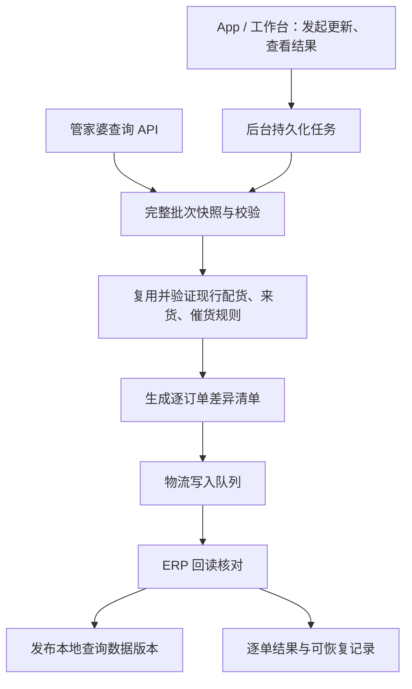

# UL 随行：订单处理更新 API 方案

日期：2026-09-16。状态：设计方案，未切换生产数据源，未执行 ERP 写入。

2026-09-21 决策补充：后续取得可用 Token 后，按“总在途量 = 可销售库存 - 实物库存 + 销售未完成数量”补齐普通采购与委外采购在途，再通过实际入库流水维护来货分配。负数推算必须进入数据冲突保护。静态对照、实测耗时和后续库存流水方案已记录在 [物流更新与库存流水路线记录](ERP_API_LOGISTICS_AND_INVENTORY_LEDGER_ROADMAP_2026-09-21.md)。

2026-09-17：WMS 入库查询的模型存在进货订单类型 7、待收/部分待收/收货中状态，但本账套范围查询及已知采购单测试均为空。采购未到数量尚未接通；下一步确认普通订单进入 WMS/PDA 的条件、货主/权限配置及 qty 口径。见 [只读实测](ERP_WMS_PURCHASE_PENDING_2026-09-17.md)。

21:22 最新补充：已通过 WMS 范围查询取得同一未完成订单的 137 字符系统备注，与原销售备注空格转下划线后完全一致，同号同商品核验通过。奇门完整解码后仍未返回该文本，原因未定。WMS 精确筛选有异常，范围查询的全量与更新延迟也未验收，暂不接管生产。详见 [同单备注映射报告](ERP_ORDER_REMARK_MAPPING_2026-09-16.md)。

后续实测见 [只读核查报告](ERP_API_READONLY_AUDIT_2026-09-16.md)：分类编码已验证无重复，入库样本可对照；奇门接口已读出对应本地 1,816 个订单号的记录。当前需处理分页重复、备注/物流空值及内部 ID 为零的问题，物流写入未实测，暂不具备完整切换条件。此前两个发货单接口返回空仅代表各自测试结果。

后续用户确认：110 条源表差异已处理，不再追查或作为阻塞。采购补查 `beefun.gjsstockbilldetail.list` 实际对应已过账进货明细，没有采购未完成数量、仓库等字段；采购未到订单读取仍待接通。最低需求以现行分类/催货算法为准，不为价格、金额等非必需字段增加本轮门槛。

20:48 补充：销售出库明细 `erp.bill.getsalebilldetails → details[].comment` 已在 3 个有出库记录的源订单样本中取得完全一致的原备注。该路径可作已出库记录的补充来源，不能据此宣称未出库订单备注已覆盖；奇门表头/明细/扩展中的备注在本次样本仍为空。

## 1. 结论与业务约定

官方有按订单编号批量修改物流信息的接口，可以建设后台更新任务，由 App 和工作台调用。完整取代当前自动化，还需要核实销售订单、采购未到和实际入库的数据覆盖，不能把接口连通等同于全部字段已齐。

用户已确认：

- 订单本身为普通业务，只借用网店功能发货。销售出库读取固定使用 `dlytype=-1`（全部），不再以界面所在网店菜单推断业务类型或将店铺类型 1000 用作该参数。

- 库存分类仅 LS库存件、LD库存件、LM库存件、DQ库存件、QT库存件，不新增通用“库存件”。原有需采购、待到货、来货件、催货、异常继续保留。
- 现行业务运算不会产生通用“库存件”。迁移时以现行结果为验收标准；历史代码的通用兜底不移植。若新流程产生非法分类，判为规则或输入异常，不擅自映射到 QT。
- 重复物流编码已由用户修正。实际接入时重新读取字典，不使用此前缓存。
- 系统备注来自订单备注，只将普通空格转换为下划线。它不是独立录入的数据。

## 2. 接口证据与待验证项

| 能力 | 证据级别 | 接入前需要确认 |
|---|---|---|
| 商品、仓库、库存 | 独立工具已实测部分样本成功 | 全量分页、单位、仓库口径、实物库存与可销售库存对齐 |
| 物流分类字典 | 此前已成功读取 | 重新获取修正后的名称、编码和 ID，一一匹配 |
| 修改订单物流 | 官方文档支持，未实测业务写入 | 当前账套权限、订单号口径、状态限制、批量上限和限流 |
| 奇门读取当前订单 | 已实测 19 页，1,868 条表头去重为 1,816 个源表订单号；110 单差异用户确认已处理 | 52 条完全重复需去重核对，备注/物流空值、内部 ID 为零；尚未达到完整同步条件 |
| 单据明细、物流、附加说明 | 单据中心文档支持，未验证当前业务全量覆盖 | 未完成销售/采购订单是否在范围内，备注字段是否就是当前导出的备注 |
| 销售出库明细的原订单备注 | 3 笔 `details[].comment` 与源表原文完全一致 | 仅验证已有出库记录的样本；未出库备注、关联稳定性及完整范围待补齐 |
| 实际进货入库、退货、红冲 | 文档存在相应单据类型及字段 | 实际权限、行唯一标识、日期、正负方向、红冲配对和完整性 |
| 销售未完成数量、终止数量、订货/到货日期 | 尚未证实全部可读 | 请厂商提供对应的订单查询/明细接口与字段定义 |
| 采购未到数量、供应商、订货日期、仓库商品关系 | 尚未证实全部可读 | 需要进货订单统计列表对应查询，准确包含部分收货/终止后的有效未到量；采购金额、价格与采购到货日期不是当前规则必需门槛 |
| 管金所进货单详情 | 已只读实测 20 条，均对应本地进货明细 | 可作已入库辅助来源，不能代替采购未到量；正式入库来源优先单据中心 |
| ERP 系统备注写回 | 物流修改接口未列出该字段 | 若旧 ERP 标签仍使用它，须另找对应修改接口 |

官方来源（本次已读取页面）：

- [修改物流信息](http://d7safe.mygjp.com.cn:8020/web/#/erpapi/1007)：`beefun.orderfreight.updatefreight`，列表参数 `freightinfos`；每项为 `tradeid`、`freightname`、`freightcode`、`freightnumber`。必须检查每笔结果，不能只检查请求外层成功。
- [单据汇总查询](http://d7safe.mygjp.com.cn:8020/web/#/erpapi/1014)：`erp.bill.billcenterlist`。可按日期/类型/单据 ID 分页读取，存在商品明细、仓库、附加说明、自定义字段和物流字段。日期筛选的准确语义、订单覆盖范围及样例结构仍需实测。
- [常用单据类型](http://d7safe.mygjp.com.cn:8020/web/#/erpapi/1708)：列有进货入库、退货等，不能据此推定未完成采购订单也已覆盖。
- [奇门查询订单](http://d7safe.mygjp.com.cn:8020/web/#/erpapi/1781)：`qimen.taobao.erp.order.sync` 已命中当前订单，`trade_id`/`raw_no` 与本地订单号对应，商品编码对应。需核实范围差集、补齐字段，并验证物流更新接口的同名参数是否相同口径；不能仅根据接口名称排除其用途。
- [物流信息回传](http://d7safe.mygjp.com.cn:8020/web/#/erpapi/1127)：`beefun.deliver.updatefreightinfo` 为发货单场景，不与订单物流接口混用。

## 3. 后台结构

采用现有 Python 后台内的独立模块和持久化任务，不另建一套手机规则、不为 4 人规模引入多套微服务。5192 继续作为独立授权验证工具；正式任务接入业务后台时增加专用 API 适配器。

模块职责：

- `erp_adapter`：认证续期、签名、分页、限流、错误归一化；密钥不进入 APK。
- `sync`：抓取并标准化数据，保留来源 ID、时间和完整性证据。
- `allocation`：仅接受标准化快照，执行现有业务规则，不请求网络、不修改 ERP。
- `publisher`：写入前比对、提交、回读和冲突处理。
- `jobs`：单任务互斥、进度、断点续办、操作人和结果。
- `app_api`：提供触发与查询入口；普通包装人员可查结果，更新权限按角色授予。

数据库沿用现有技术，不强制迁移。逻辑上分开源数据、计算结果、来货分配账本、同步任务、写入记录。打印记录与报损报溢队列不因订单同步或快照回退而清空。

## 4. 最小数据合同

销售出库的数据读取采用“表头查询 → 明细查询 → 商品/仓库资料关联”：先用 `erp.bill.getsalebilllist`、`dlytype=-1` 分页获得 vchcode，再用 `erp.bill.getsalebilldetails` 按 vchcode 获取行记录。明细以 dlyorder 为标识；优先关联 ptypeid/skuid，不能假定商品编码与名称字段始终有值。该组合提供出库记录，不自动等价于销售订货的未完成明细；未完成数量、终止数量和到货日期仍须有独立可靠来源，不以出库数量代替。

| 数据 | 必要字段 |
|---|---|
| 商品/仓库 | ERP 商品 ID、商品编码、SKU、仓库 ID、名称、规格、型号、单位及单位换算 |
| 销售订单明细 | 稳定订单/明细 ID、用于物流更新的订单号、商品、仓库、订货日期、到货日期、未完成数量、终止/关闭状态、原始备注 |
| 库存快照 | 仓库+商品+SKU+单位维度、实物库存、可销售库存、抓取时间；不能跨仓库混加 |
| 采购订单明细 | 稳定订单/明细 ID、供应商 ID、商品、仓库、订货日期、有效未到数量、交期及取消/终止状态 |
| 实际收货流水 | 单据/明细 ID、商品、仓库、数量、业务日期、出入方向、退货/红冲标识、原单关联 |
| 物流当前值 | 订单映射、当前分类名称/编码/ID、当前物流单号、可写状态 |
| 既有业务账本 | 收货批次对订单的已分配数量、分配时间与来源，原样迁移并验证 |

金额和数量用十进制定点处理，ERP 长整型 ID 以字符串传输，保留前导零编码。销售订单、发货单、行号不靠商品名称或数组下标关联。

先逐字段和当前有效导出数据对照，再决定是否允许差额推算未完成数量；终止、退货和单位换算口径未确认前不推算。缺失数据不默认填零。

## 5. 备注与标签兼容

- 保存 `remark_raw` 原始备注，保留空格、下划线、换行。
- 另生成 `remark_legacy = remark_raw.replace(" ", "_")`，不覆盖原文，不对所有空白字符做笼统压缩。
- 多行订单备注的合并、去重和顺序以现有有效输出为基准，保留行对应关系。
- App 可以从原始备注解析标签并生成兼容文本；但不能因此声称旧 ERP 的系统备注已同步。
- 如 5088/ERP 打印仍依赖系统备注，完全切换的前提是补齐其写入接口并验证。缺接口时保留旧链路完成该字段，不把半同步标记为完整完成。
- 禁止把所有 `_` 全部反向替换成空格：原文本身可能有下划线。标签的标准号与规格间距另按明确字段排版。

## 6. 一次更新的执行顺序

1. **领取任务**：返回任务 ID；同一账套只有一个更新任务。重复点击返回既有任务。旧自动化与新写入任务也必须互斥，切换时避免两者交错覆盖。
2. **读取数据**：按确认的时间范围、所有页和有效状态读取，保留未结老单。初始范围与旧系统对齐；不能用简单的“最近一个月”替代历史采购覆盖。
3. **完整性校验**：检查分页总数、重复 ID、单位、仓库、必要字段与日期。若 API 不提供一致性快照，固定抓取边界并复核抓取期间变化；不能将不同时间的几类数据当绝对同时快照。
4. **保存快照、计算分类**：使用经对照验证的既有逻辑，保留来货批次账本。不新增通用库存件，不把打印完成等同于包装完成。
5. **差异清单**：按订单对比现值和目标值。只提交真实变化；现值未知则不能仅凭上次成功记录跳过。原备注和目标兼容备注也纳入完整性判断。
6. **写入前复核**：检查订单存在、状态可写、分类映射唯一以及现值未被人工修改。发生冲突重新读取/重新计算，不强行覆盖。
7. **分批提交**：使用官方物流更新接口，首批串行小批量；批量大小和频率配置化，上限以厂商确认/实测为准，不宣称文档支持某个固定数值。
8. **逐单记账并核对**：区分未发送、发送中、返回成功、已核对、失败、结果未知和冲突。外层请求成功不代表每张单成功。
9. **发布数据**：完整源快照校验通过后原子发布本地数据版本；保留每单 ERP 同步状态。部分写入成功必须显示“部分完成”，不能让本地版本切换伪装成 ERP 整批原子更新。

原流程是全量导入；改为差异写入是有意的同步层优化。计算和完整读取仍覆盖全部目标订单，验收时逐订单目标结果必须一致。

## 7. 失败、重试和恢复

- 拉取失败：保留上个可用版本，显示更新时间，不开始新批次写入。
- 限流/临时故障：有限次数退避重试，遵守服务端提示；权限、分类错误、状态不允许不无限重试。
- 写入超时/连接中断：记为“待核对”，先读 ERP 现值；若已等于目标则补记成功，否则在确认可写后重试。没有可靠回读接口时不能安全自动重发未知结果。
- 后台重启：从数据库恢复任务；把遗留“发送中”转为待核对，不能重新盲发整个批次。
- 业务字段被他人修改：报冲突。接口未提供条件更新时，写前复核仍有竞争窗口，需互斥现有脚本、缩短时间并回读，不承诺绝对无并发覆盖。
- 回退本地版本不等于回退 ERP。恢复 ERP 原值只针对确认由本次修改且现值仍等于本次目标的记录，走可审计的补偿任务；不覆盖后续人工修改。
- 快照、规则版本、字典版本、来源批次、变更前后值、逐单结果保留；日志不记录密钥或完整敏感原始响应。
- 一致性备份含业务账本和未决任务，至少可恢复到上一次成功更新；恢复演练目标沿用用户要求：2 小时内恢复、最多损失一轮更新。

## 8. App 交互

延续现有红白黑、简洁布局，在设备/数据页放“订单处理更新”。默认只展示：上次成功时间、一个更新按钮、当前阶段，以及完成后的成功/无需更新/失败/待核对数量。

任务在后台执行，离开页面或关闭 App 不取消。点异常数字进入具体订单和原因，提供“重新核对”或“重试失败项”；普通用户不接触接口字段、Token 和分页设置。

无需公网 IP：公司电脑主动通过 HTTPS 调用官方接口，App 仍在当前局域网访问后台。公网部署继续不在本次范围。

## 9. 实施与验收顺序

1. **字段对照验证**：读取小范围真实样本，核对正常未完成、部分完成、终止、来货、退货和红冲；确认订单号关联与可写条件。此阶段不修改 ERP。
2. **全量只计算**：同一批输入运行新旧规则，比较每单分类、物流单号、备注和来货分配账本；差异逐项解释，不能只比订单总数。
3. **受控写入验证**：选定可恢复的测试订单，保存现值，验证写入、逐单失败、回读、重复触发和超时恢复。此项待实施阶段开展，本次未执行。
4. **小范围 API 发布**：确认备注兼容后，仅选定订单走新路径，其他走旧路径；不能让同一订单两条路径并发写。
5. **完整切换与 App 接入**：全部必需字段通过、连续运行核对一致后再切换。保留旧版本回退入口，停止旧任务的重复写入。

在厂商字段确认前，不承诺可以完全取消所有导出/导入。可先更换物流写入环节，但必须明确仍依赖的数据导出和备注写入，不包装成“全 API”。

## 10. 可直接发给管家婆技术支持的问题

我们使用管家婆云 ERP，希望通过官方 API 替代“销售订单统计列表 + 采购订单统计列表 + 实际入库明细 + 导入物流信息”的流程。请协助确认：

1. 获取所有未完成销售订单及明细应使用哪个接口？需订单号/行 ID、订货日期、到货日期、未完成和终止数量、仓库、商品、原始单据备注；需覆盖较早创建但仍未完成的订单。
2. 获取采购订单有效未到数量、部分收货、终止状态、供应商与交期使用哪个接口？能否关联实际收货/退货/红冲明细？
3. `beefun.orderfreight.updatefreight` 的 tradeid 与上述销售订单编号是否直接对应？当前账套有哪些权限/状态限制？每批上限和调用频率是多少？
4. 与 Excel“导入物流信息”中的“系统备注”对应的读写字段和接口是什么？内容是订单备注将空格替换为下划线，需更新现有订单，不是新增订单。
5. 如何按订单查询物流公司、物流单号和系统备注的写后结果？是否支持条件更新或幂等请求标识？
6. 查询日期代表创建、业务、过账还是修改日期？能否按修改时间增量获取，如何获取删除/终止/红冲变化，分页是否有稳定排序或快照机制？

本方案不包含密钥、Token、账号密码，也没有修改 5088、5191 或 ERP 业务记录。
