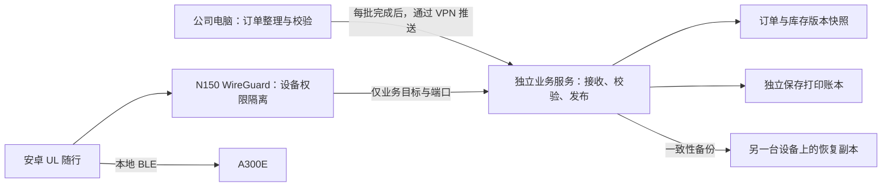

# N150 远程访问与 UL 随行服务评估

检查日期：2026-09-09，约 23:10–23:31（北京时间）。本轮仅执行本机网络查询、域名解析、LuCI 登录与只读查看、普通网站连通检查及本地代码审阅。已退出路由器管理会话；未修改网络、DNS、OpenClash、WireGuard、服务配置或公司数据，未安装、部署、重启。本文不包含密码、私钥、订阅地址或控制 API 密钥。

## 结论与服务目标

用户要求：预计 4 人使用，允许停机 2 小时，订单数据最多退回一次更新。先按内部订单、库存查询和手机 A300E 打印规划，不默认面向客户开放。

现有公网和 VPN 已有可用基础，实测资源支持继续验证轻量业务。当前 iStoreOS 是 N150 上的 QEMU 虚拟机，不能把该虚拟机的资源当成整台 N150 的配置。优先核验宿主机后，在有余量时用独立 Linux 虚拟机承载业务；iStoreOS 继续负责网络和 VPN。资源不足时才评估路由虚拟机内的受限容器。当前证据不足以保证所有故障均能在 2 小时内恢复。

## 本轮已验证

| 项目 | 实测结果与含义 |
| --- | --- |
| 当前电脑 | WLAN 为 192.168.1.5/24；windows-client-2 为启用的 WireGuard 接口，地址 172.27.88.5/32。 |
| 到家庭后台的路径 | 本机到 192.168.100.1 的选路落在 windows-client-2；直连 HTTP 收到 LuCI 登录页，随后成功登录。 |
| 当前电脑的 VPN 路由 | 存在 0.0.0.0/1 和 128.0.0.0/1 两条默认分割路由，VPN DNS 为 192.168.100.1。这是覆盖 IPv4 默认流量的设置，更具体的路由仍可优先；不是本轮所需的仅业务分流。未修改。 |
| 普通上网样本 | 强制 IPv4、绕过 HTTP 代理配置请求百度和 GitHub，均 HTTP 200，分别约 0.16 秒和 3.04 秒。这是当次小样本结果，不能证明历史断网原因已排除。 |
| 系统 | QEMU Standard PC（Q35 + ICH9），架构字段 Intel N150，x86/64；iStoreOS 24.10.7 2026060510，内核 6.6.141。运行约 33 天。 |
| 分配资源 | Docker 概况显示 2 个线程；LuCI 内存总计 1.87 GiB，可用约 1.54 GiB；瞬时平均负载约 0.28 / 0.32 / 0.29。不能代替峰值负载测试。 |
| 存储 | /mnt/data 对应 /dev/sdb1，总计 29.36 GiB，已用约 1.08 GiB；磁盘呈现为 QEMU 虚拟盘，物理盘健康未知。 |
| Docker | 服务运行，版本 27.3.1，容器 0、镜像 0。根目录 /overlay/upper/opt/docker 对应 /dev/sda3，仅约 1.90 GiB，概况显示可用约 1.78 GB。不能直接把镜像、日志和数据库都堆进去。 |
| 家庭 WAN | iStoreOS 的 pppoe-wan 直接显示公网 IPv4 153.34.4.88/32，连接约 4 天 20 小时；LAN 为 192.168.100.1/24。没有用代理出口代替 WAN 地址。 |
| 域名与 DDNS | 本机查询 yingyinghome.com 和 vpn.yingyinghome.com 的 A 记录均为上述 WAN 地址，均未获得 AAAA。LuCI 显示 myddns_ipv4 管理 vpn.yingyinghome.com，绑定 wan，登记地址一致；主域名是否自动更新尚未核实。 |
| WireGuard 服务 | wg_home 运行，172.27.88.1/24，实际监听 UDP 51820，设备 MTU 1420；pppoe-wan MTU 1492。端口来自实测，不是默认假定。 |
| VPN 活跃证据 | 23:16 左右，服务端 windows-client-2 的最近握手为北京时间 23:14:31，有累计双向流量，传输端点为不同于家庭 WAN 的公网地址。这支持当前存在外部对端连接，尚不能代替 4 台手机的移动网络验收。 |
| 对端配置与运行差异 | 配置页包含 .2、.3、.4、.5、.6 五个独立 /32 地址；运行页和路由仅列出前四个，对应 .6 的 this-computer 原因待核实。配置页的停用框均未勾选；不因此判定第五个已生效，不重新分配这些地址。 |
| 历史停用接口 | wg_astrill 未连接，显示开机时未启动，未改变。 |
| VPN 权限范围 | wg_home 与 br-lan 同属 lan 区域，输入、输出和区域内转发允许；当前规则允许到 WAN、Docker 等区域。员工不能直接照搬这个信任范围。 |
| 现有入站与转发 | 生效规则包含 WAN UDP 51820 和 TCP 8897 放行；另有 TCP 80、443、8443 转发至 192.168.100.30。规则存在不代表全部端口已做外网可达验收。8897 的业务用途、.30 的服务归属待确认。 |
| Docker 网络规则 | 现有 Docker 区域匹配 172.16.0.0/12，范围包含 172.27.88.0/24；实际路由中的 docker0 为 172.17.0.0/16。这是需要检查的防火墙分类范围重叠，不等同于已证实路由冲突。 |
| 代理与 NAT | 生效规则含 OpenClash DNS 接管、TCP 重定向、UDP 标记及策略路由；WAN 有 FullCone NAT。现有 VPN 经家庭上网会经过这些链路，不能仅凭一个 AllowedIPs 值解释历史断网。 |
| OpenClash | Meta 运行中，当前选中的配置路径为 /etc/openclash/config/stable-subscriptions.yaml，规则模式，Fake-IP 增强模式；其余历史配置文件仍在列表。没有切换、更新或读取含秘密的完整配置。 |
| SSH | LuCI 配置显示 Dropbear 实例启用、端口 22、未限定接口、允许密码和 root 密码登录。未尝试 SSH 登录，未将配置状态等同于真实监听或外网可达。 |

历史交接中的 provider 刷新间隔、主组选择、各订阅健康和 ChatGPT 专用组具体节点，本轮没有重新读取配置或控制 API 核验，仍标为历史信息；所有这些设置原样保留。DDNSTO 界面显示正常，但未核实远程映射和身份控制，不能把它当成公司员工入口。

## 尚不能确认

- N150 宿主系统、整机 RAM、物理磁盘容量与 SMART、现有其他虚拟机、可分配资源、存储是否共用同一物理盘。
- 上行带宽与高峰延迟、长期丢包、电源保障，以及故障发生时是否有人可在家中处理。
- 主域名自动更新机制、运营商长期入站限制。当前 PPPoE 公网地址在路由虚拟机上且 VPN 有握手，不需要据此假设新增上级端口转发；物理光猫和宿主网络拓扑仍需交接。
- 公司其他网络/VPN 的全部路由范围。已知公司 192.168.1.0/24 与家庭 192.168.100.0/24 不重叠，但本机还存在 10.0.9.38/8 的虚拟接口，新增网段应检查完整路由后确定。
- Windows 客户端的实际 Endpoint、客户端 MTU、保活值：本机 wg 状态读取因权限不足未取得；没有导出配置或读取私钥。服务端看到的传输端点是客户端来源，不能当作客户端配置的服务器 Endpoint。
- .6 对端未出现在运行状态的原因；现有 TCP 8897 服务和 192.168.100.30 的职责。
- 手机移动数据下的查询、权限、打印速度和连续出纸表现，以及所有原用户是否仍可用。本轮不宣称完成外网验收。

## 建议架构

这里的“独立业务服务”是建议位置，尚未创建：若宿主资源允许，优先新增 Linux 虚拟机，初始以 1–2 vCPU、约 1 GiB 内存和独立持久盘作为测试起点，容量由 4 人负载实测调整，不挤占路由已分配资源。这样应用更新和异常可单独处理；同一 N150 的供电、宿主和物理盘仍然是共同故障点。若有可用独立主机，放在 N150 后面能进一步隔离这些风险，不需为此先购买设备。

备选是在当前 iStoreOS 内运行受限容器，业务数据和轮转日志放到 /mnt/data 的专用目录；必须先解决镜像分区空间及现有 Docker 防火墙过宽问题。首页显示 SAMBA 已启用并共享 /mnt/data/nas，业务数据和含秘密备份必须放在共享范围之外并限制权限。禁止特权容器、挂载 Docker 控制套接字或为图方便使用 host 网络。独立容器并不自动等于隔离完成。

手机先用单独的 WireGuard 客户端建立获准连接，UL 随行继续保持原生界面和 BLE 打印。每台设备自己的密钥、地址和业务账号，不把 root 密码交给员工。业务 API 需有效 HTTPS 和认证；员工只获查询/打印权限，PC 数据推送用独立凭据。采用 VPN 内 HTTPS 不需要占用现有公网 80/443 转发；域名和证书方式待 DNS 服务商及现有服务确认后单独设计。

新员工接入不能仅依赖客户端 AllowedIPs。它决定路由和隧道地址关系，服务目标与端口仍须通过防火墙限制；这是基于 [WireGuard 官方工作原理](https://www.wireguard.com/) 作出的权限设计。应优先保留现有家庭管理接口和对端，为公司接入建立独立权限范围；实现为新增隔离接口还是有明确优先级的规则，需先核实网段和现有 Docker 匹配范围再给出精确差异。

## 数据同步、备份和恢复

1. Windows 继续承担 Excel 读取、原有销售过滤和特殊表格转换。整批订单处理成功后，输出 App 真正需要的订单、物流公司/单号、需求数量、库存/可销售库存、标签字段、来源时间、批次号与校验值。不上传不必要的价格、凭据和全部原始目录。
2. N150 完整接收、校验字段与数量后，事务发布新版本并回执。禁止用收到部分数据的文件直接替换正在查询的版本；失败继续展示最后成功版本及更新时间。
3. 每个成功批次在 PC 和业务主机分别保留，至少可取当前与上一有效版本；建议另做 7 天逐批及 30 天每日保留，实际按包大小配置上限。这些保留策略尚未创建。
4. “最多退回一次更新”按批次衡量，不是每两小时备份。若连续两次更新未在远端确认，远端已经落后两批，应提示同步异常；不能声称远端新鲜度仍合格。旧数据仍可查询并标明过期，但建议阻止基于过期版本新建打印任务，等待补齐或人工确认。
5. 打印账本由业务服务独立维护，包含幂等键、冻结指令、领取和发送结果。数据同步只更新业务快照，不能覆盖整个 SQLite；回退订单版本不能顺带回退打印账本。备份使用 SQLite 一致性备份方式，不能只复制正在写入的主数据库文件而忽略 WAL。
6. 打印账本需要比订单快照更频繁的异机保护，并结合手机已持久化的尝试记录核对。数据库记录“已发送”也不能证明已出纸；故障恢复存在不确定区间时必须保留待核对状态，不自动补打。不能声称恢复旧备份后仍天然具备绝对不重复打印保证。
7. 2 小时恢复目标应覆盖 4 人查询、数据版本核对、打印任务准备、领取防重和结果登记。应用故障可通过旧镜像和一致性备份恢复；硬盘、宿主、家中断电或宽带故障还需要异机副本、可用备用主机与事先验证的访问入口，否则无法承诺同一时限。保留 5088 可保障公司现场原流程，但不等于手机外网故障已恢复。

## 后续最小改动、影响与回退（均未执行）

| 阶段 | 具体变动和影响范围 | 变更前备份与回退 |
| --- | --- | --- |
| 1. 确定业务位置 | 确认宿主资源、磁盘和现有 .30 服务；有条件时在宿主新增独立业务虚拟机。若选择容器，先解决存储和防火墙边界。 | 保存路由与宿主网络配置、现有服务清单；新业务可单独停止/移除。不得为新增服务重装路由或重分区。 |
| 2. 公司访问隔离 | 建立员工自己的设备身份和仅业务分流；核对并避免 Docker 的宽泛网段匹配绕过隔离。保留家庭管理对端。 | 受限位置保存接口、防火墙、路由和 DNS 配置及密钥备份；记录精确规则差异。使用备用管理通道或本地人员保障回退，不能在唯一管理链路上冒险变更。 |
| 3. 数据接收模式 | 5191 后端新增 Linux 接收模式，停止该模式下的 Windows 文件监视；PC 成功处理后发布标准化批次。同步失败重试不阻塞原 5088。 | 备份现有脚本和数据清单；停用新增推送即可回到原流程，业务服务保留最后有效版本。打印账本不随数据回退。 |
| 4. 账号、HTTPS 和 App | API 新增账号/设备认证和 PC 上传权限。App 配套传递身份、状态提示和服务器配置。现有 HTTP 白名单在 XML 与 Kotlin 两处限定生产 IP 为 192.168.1.5；VPN 不会绕过该限制，有效 HTTPS 域名可作为地址。 | 保留原 APK、签名、配置及版本说明；地址切换前结束发送并处理未决任务。回退不清除 unknown 状态，不通过关闭认证恢复访问。 |
| 5. 恢复与验收 | 配置异机备份、批次滞后告警、服务健康、磁盘/日志上限；演练恢复后再接入 4 台设备。 | 记录真实备份路径、恢复步骤与耗时；新增服务异常单独回退，保留 5088。备份位置先经确认，本文不把建议目录写成已存在。 |

路由凭据曾明文出现在聊天，建议单独安排更换强密码、核对现有管理连接和密码保管；本轮没有改密。含密钥配置备份只存受限位置，报告只记录位置。WireGuard 的保活应按实际 NAT 状态决定，不机械套用参数；官方也说明不需要时不应开启：[WireGuard Quick Start](https://www.wireguard.com/quickstart/)。

## 验收与需要补充的资料

后续实施前还需要：N150 宿主系统及整机内存/硬盘、192.168.100.30 与 TCP 8897 的用途、可用的异机备份位置及上行带宽。按当前会话先假定只供内部 4 人使用；若包含客户、金额或更多敏感数据，需重新划分账号和字段权限。

正式验收必须包括：手机关闭家庭 Wi-Fi 使用移动数据；每台设备近期握手与流量；允许的 API 可用且员工管理/家庭其他服务权限被拒；普通上网、原有 VPN 用户及 OpenClash 使用正常；每批数据完整同步与旧版本提示；4 人并发查询及打印领取；连续扫码打印与断线待核对；一次同步失败、一次批次回退以及一次服务恢复演练。记录停机时长不超过 2 小时、恢复批次最多落后一批，并核对打印账本。

本轮仅验证了现有电脑的访问链路与路由器状态。上述新增服务、权限、同步、备份与手机外网验收均待后续确认和实施，不能视为已完成。
